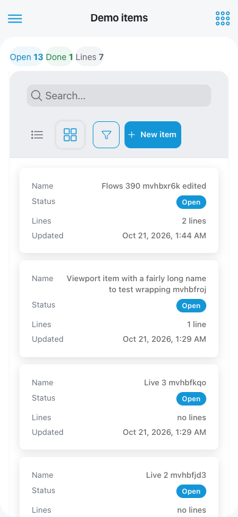

<!-- generated from WORKBOOK.md sha256:df13dfd434f8f81d77f45bc1b2a1dd79931b46291f23b67b5decb5350e9a5107 -->

## What it is for and who it is for

Demo keeps **items** with a name, a status ("Open" or "Done") and a note, and each item carries a
list of **lines** (text and quantity). It solves no business problem: it is there to check, on the
tablet, that the platform works end to end.

- Whatever is created, changed or deleted on one tablet shows up on the others **in under a second**,
  without reloading.
- "Add line" shows **instantly**, before the server answers; if the server rejects it, the line
  disappears on its own and the reason is shown.
- A person without permission does not see what they cannot do, and the app rejects it even if they
  try through the API.

Who uses it:

- The **owner**, the **administrator** and the **manager** view, create, change and delete items and
  add lines, and see the figures.
- The **employee** only sees the list and the item page.

## Reference adopted

It is the list-and-detail pattern of any back office on the market (Odoo, Shopify, Square Dashboard):
a paginated list with a search box and a status filter, a detail page with its lines, a form with
the error next to each field, and deletion with confirmation. The line that appears instantly and is
undone if the server rejects it is the "optimistic update" of Linear, Trello or Google Docs. Safely
repeating a request with an identifier set by the client is Stripe's idempotency key. An item page
that is deleted elsewhere, or that the person can no longer see, stops showing it and says why, like
Odoo's "record that no longer exists".

## Before you start

- You need to sign in with an account that has a role in that business. Demo has no sign-in of its
  own: without a session, it takes you to the ERPlora sign-in, which comes back to the business with
  your role.
- In phase 1 the business is the **first part of the address** (business `a` and business `b`). In
  phase 2 each business will have its own data.
- ⚠️ In phase 1 both businesses **share the items**. What is already kept apart is the **live
  notice**: saving in `a` only refreshes the screens open in `a`. Those in `b` see the change when they
  reload or with the next notice of `b`.

## Screens

Demo opens from **"My apps"**, at the top right, and has two screens and two forms.

### Items (list)
A table with Name, Status ("Open" / "Done"), Lines (how many it has) and Updated. A "Search…" box by
name (not case-sensitive); the funnel opens "Filters", with the status one ("All", "Open", "Done"); 50
per page (it can be changed), from the most recently changed to the oldest, as a table or as cards; on
a phone, "Load more". A **"New item"** button only for those who can manage. Tapping a row opens the
item page. Above it, the figures "Open", "Done" and "Lines", only for those who can manage.

### Item page
Name, status, note and the list of lines (text and quantity, in the order they were added). Actions
for those who can manage: "Edit", "Mark done" (or "Reopen"), "Delete", "Save note" and "Add line". If
someone else changes the note while you are writing it, your note **is not overwritten** and "Updated
elsewhere" is shown, with "Reload" to take the other person's. If the item is deleted elsewhere, or
the person can no longer see it, the page stops showing it and says why.

### New item and Edit item (forms)
Fields Name (required, up to 120 characters), Status and Note. "Save". A value that is not valid is
shown under its field and nothing is saved. Those who cannot manage see "You do not have permission"
instead of the form.

## States of each screen

| State | What the person sees |
|---|---|
| Loading | "Loading…" on the list and a spinner on the item page while the first result arrives. |
| Empty | "No items yet" (or "No results" if there is a search or a filter), with "New item" if they can create; an item page without lines, "No lines yet". |
| Error | "The items could not be loaded" with "Retry"; on the item page, "The item could not be loaded" with the reason. |
| Reconnecting | What is on screen stays; a banner says "Reconnecting…" until the connection is back. |
| App inactive | "This app is not active in this business". It does not retry on its own: it comes back when the app is activated. |
| No permission | What they cannot do does not appear; if they get there another way, "You do not have permission". |

## Flows

| ID | Flow | Status |
|---|---|---|
| DEMO-F01 | Create an item | done |
| DEMO-F02 | Edit an item | done |
| DEMO-F03 | Delete an item | done |
| DEMO-F04 | Add a line instantly (optimistic and idempotent) | done |
| DEMO-F05 | See the change on another tablet in under a second | done |
| DEMO-F06 | Try it without permission | done |

### DEMO-F01 Create an item
Status: done
Actor: administrator, manager
Screen: Items
Steps:
1. In **Items**, tap "New item": the "New item" form opens.
2. Type the Name; Status ("Open" to begin with) and Note are optional.
3. Tap "Save". You are back on the list and the item comes first, with "no lines".
In: nothing from other apps.
Out: the item, in a single step; Demo announces a new item (`demo.item.created`) and the list and
the figures refresh.
If it fails: an empty Name (or only spaces) or one longer than 120 characters is shown under the
field and nothing is saved.
Involved: none

### DEMO-F02 Edit an item
Status: done
Actor: administrator, manager
Screen: Item page
Steps:
1. On the item page, tap "Edit": "Edit item" opens with the saved data.
2. Change what you need and tap "Save". Only what you touched changes; the rest stays as it was.
3. You are back on the item page with the new data, and the item moves to the top of the list.
4. Without opening the form, on the same page: "Mark done" (or "Reopen") changes the status, and
   "Save note" saves the note written.
In: the item as it is saved.
Out: the changed item; Demo announces the change (`demo.item.updated`). Saving without changing
anything notifies nobody.
If it fails: the same rejections per field as when creating. If the item no longer exists (someone
else deleted it): "This item no longer exists."
Involved: none

### DEMO-F03 Delete an item
Status: done
Actor: administrator, manager
Screen: Item page
Steps:
1. On the item page, tap "Delete": "Delete this item and its lines?" is shown.
2. Tap "Delete" to confirm ("Cancel" deletes nothing). You are back on the list and the item is no
   longer there, nor its lines.
In: the chosen item.
Out: the item and its lines, deleted; Demo announces it (`demo.item.deleted`). The other tablets that
have its page open see "This item no longer exists.", without the item or its buttons.
If it fails: "This item no longer exists." if someone else deleted it first.
Involved: none

### DEMO-F04 Add a line instantly (optimistic and idempotent)
Status: done
Actor: administrator, manager
Screen: Item page
Steps:
1. On the page of an open item, type the text and the quantity and tap "Add line".
2. The line appears **right away**, at the end, before the server answers.
3. When it answers, the provisional line is swapped for the saved one without anyone noticing.
In: the item, its status and its lines.
Out: the line, at the end (the position after the last one), and the item as just changed; Demo
announces it (`demo.item.line_added`). Repeating is safe: each line carries an identifier set by the
tablet, and if the same line arrives twice (a retry because of poor coverage), the second one returns
the item page as it is, **without duplicating the line or notifying again**; with the same
identifier, the first line saved wins, and a retry of a line that already went in is accepted even if
the item was closed afterwards.
If it fails: if the item is "Done", the provisional line **is undone** and "This item is closed: open
it to add lines." is shown. Without text, "Add line" cannot be tapped, and the text does not go past
200 characters; a quantity that is not greater than zero (up to 3 decimals) is shown under its field.
If the item no longer exists: "This item no longer exists."
Involved: none

### DEMO-F05 See the change on another tablet in under a second
Status: done
Actor: anyone with permission to view
Screen: Items and Item page
Steps:
1. Open the list (or the same item page) on two tablets of the same business.
2. On one, create, change, delete or add a line.
3. The other shows it in under a second, without reloading.
In: the notices of Demo of that business.
Out: the list, the item page and the figures up to date. Each screen receives the whole result,
never the bare notice.
If it fails: without a connection, what is on screen stays with "Reconnecting…"; when it comes back,
the whole results arrive. What is done in `a` does not notify the screens of `b` (nor the other way
round).
Involved: none

### DEMO-F06 Try it without permission
Status: done
Actor: employee
Screen: Items and Item page
Steps:
1. An employee opens **Demo**: they see the list and the item page, without "New item", "Edit",
   "Mark done", "Delete", "Save note", "Add line" or figures; the note is read-only.
2. If they open the create or edit form by hand, they see "You do not have permission"; if they try
   through the API or the assistant, it is rejected.
In: their role in that business.
Out: nothing changes.
If it fails: "You do not have permission". Without a session, it takes them to the sign-in. If their
permission is removed with the screen open, at the next refresh the item page stops showing the item
and says "You do not have permission".
Involved: none

## Services: what goes in and what comes out

Everything can be requested through the screens, the assistant (phase 2) and the API, with the same
rules and the same permissions.

### What it offers: queries (they read and change nothing; all of them can be followed live)

| What it gives | Who can | Flows | Service |
|---|---|---|---|
| The items, with search by name, a status filter and pages (up to 100 per page) | view | F01–F05 | `demo.item.list` |
| An item's page with its lines | view | F02–F05 | `demo.item.detail` |
| The figures: total, open, done and lines | manage | F05 | `demo.item.stats` |

### What it offers: actions (they change data)

| What it does | Who can | Flows | Service |
|---|---|---|---|
| Creates an item | manage | F01 | `demo.item.create` |
| Changes an item (only what is sent) | manage | F02 | `demo.item.update` |
| Deletes an item and its lines | manage | F03 | `demo.item.delete` |
| Adds a line; repeating with the same identifier does not duplicate it | manage | F04 | `demo.item.add_line` |

### What it announces

| Notice | When | What it carries | Service |
|---|---|---|---|
| New item | Create | Which one (`id`) | `demo.item.created` |
| Item changed | Edit with some change | Which one (`id`) | `demo.item.updated` |
| Item deleted | Delete | Which one (`id`) | `demo.item.deleted` |
| Line added | Add a new line (not on a repeat) | The item (`id`) and the line (`line_id`) | `demo.item.line_added` |

What each notice refreshes: the list and the figures, with all four; the item page, with "changed",
"deleted" and "line added".

### What it reacts to and what it needs from other apps
Nothing: Demo depends on no app.

### Who can do what

| Permission | Owner | Administrator | Manager | Employee | Service |
|---|---|---|---|---|---|
| View items | yes | yes | yes | yes | `demo.view` |
| Manage items and see the figures | yes | yes | yes | no | `demo.manage` |

The owner and the administrator always have every permission of every app; the manager and the
employee, those each app declares. The platform roles (the ERPlora team) have no role in any
business.
